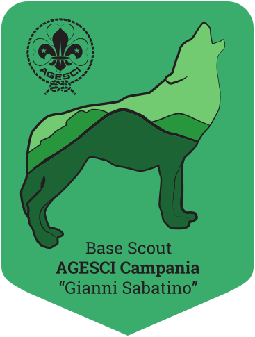

# Tana

[](https://github.com/AGESCI-Campania/prenotazionebase/actions/workflows/ci.yml)
[](LICENSE)
[](https://www.python.org/)
[](https://www.djangoproject.com/)
[](https://wagtail.org/)
[](https://www.postgresql.org/)
[](https://github.com/astral-sh/uv)
[](https://github.com/astral-sh/ruff)
[](docs/Tana_Progettazione.md)



**Tana** è la piattaforma di prenotazione e il sito della **Base Scout «Gianni Sabatino»** di
Aiello del Sabato (AV), gestita dalla Regione AGESCI Campania con la Pattuglia Operativa di Gestione.
Sostituisce i due calendari SuperSaaS (accantonamento e campo tende) e il vecchio sito Google
della base.

- un solo canale per prenotare tende, accantonamento o entrambi, con preventivo immediato;
- listini versionati, acconto, consuntivo, documenti PDF ed export per la contabilità;
- consenso del gruppo presente per uscite e giornate genitori, messaggi tra gruppi;
- area di gestione per Pattuglia, amministratori e segreteria, con login unico **Sestante**;
- sito della base modificabile senza conoscere l'HTML (**Wagtail**);
- installabile sul telefono (PWA).

La specifica completa è in [`docs/Tana_Progettazione.md`](docs/Tana_Progettazione.md).

## Sviluppo

Prerequisiti: Python 3.14 e [uv](https://github.com/astral-sh/uv) (oppure [mise](https://mise.jdx.dev)),
Docker o Podman per PostgreSQL.

```bash
mise run install        # uv sync + .env.dev da .env.dev.example
mise run up             # PostgreSQL 18 e Mailpit in container
mise run migrate
mise run dev            # http://localhost:8000  (editor del sito: /cms/)
mise run test
mise run lint
```

Senza mise: `uv sync`, `cp .env.dev.example .env.dev`,
`docker compose -f docker-compose.dev.yml up -d`, `uv run python manage.py migrate`,
`uv run python manage.py runserver`. In PyCharm le configurazioni di esecuzione sono in `.run/`.

## Produzione

Tana gira in Docker sul server delle piattaforme `*.agescicampania.net`, dietro il reverse proxy
**Caddy** di [`agesci-campania-web-frontend`](https://github.com/AGESCI-Campania/agesci-campania-web-frontend),
con lo stesso modello di installazione di Plancia 3.0. Guida passo per passo:
**[`docs/installazione.md`](docs/installazione.md)**.

| | |
| --- | --- |
| Repo sul server | `/opt/prenotazionebase`, utente `agesci` (gruppo `docker`, senza sudo) |
| Ingresso | servizio `nginx` (solo HTTP) su rete esterna `agesci-proxy`, alias `tana-nginx:80`; nessuna porta pubblicata |
| Servizi | `web` (gunicorn), `scheduler` (scadenze automatiche), `nginx`, `db` (PostgreSQL 18) |
| Variabili | `.env` (da `.env.template`, `chmod 600`, mai nel repo) |
| Avvio al boot | unit systemd `prenotazionebase.service` + `restart: unless-stopped` |
| Backup | `scripts/backup.sh` ogni notte (`prenotazionebase-backup.timer`) in `backups/` |

```bash
sudo -iu agesci
cd /opt/prenotazionebase && scripts/aggiorna.sh      # aggiornamento all'ultima release
```

**Rilascio di una versione** (dal Mac, prima dell'aggiornamento del server): versione in
`pyproject.toml`, sezione in `CHANGELOG.md`, commit su `main`, poi
`git tag vX.Y.Z && git push origin vX.Y.Z` e `gh release create vX.Y.Z` con le note della sezione.

## Licenza

Codice sotto licenza [MIT](LICENSE) © 2026 Andrea Bruno. Wagtail è distribuito con licenza
BSD-3-Clause. Marchi, emblemi e loghi AGESCI e della Base restano dei rispettivi titolari.
